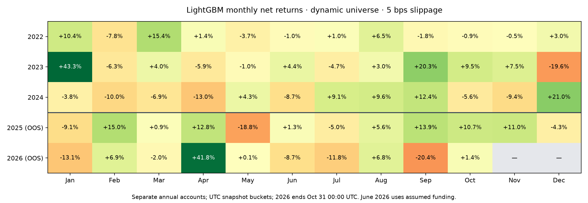

# Crypto Momentum & ML Factor Research

[](pyproject.toml)
[](src/crypto_factor_research/execution.py)
[](src/crypto_factor_research/first_window.py)
[](#results)

Crypto perpetual-futures long/short research combining momentum, funding, and
aggressive trade imbalance. The project compares LightGBM forecasts with simple
factor scores, momentum sorting, and random portfolios using NautilusTrader and
an independent accounting audit.

**Current release: dynamic-universe annual backtests for 2022–2026.** The project
covers data engineering, chronological model evaluation, TreeSHAP explanations,
execution simulation, and cost sensitivity. It is a research implementation;
paper and live trading are not implemented.

## Research question

Can a nonlinear combination of economically motivated signals improve portfolio
selection relative to transparent rules, after trading costs and funding?

| Signal group | Features | Interpretation |
| --- | --- | --- |
| Momentum | 20-, 60-, and 120-day returns | Trend persistence |
| Funding | Seven-day funding signal | Leverage demand and holding cost |
| Trade imbalance | Seven-day taker-quote imbalance | Aggressive buying versus selling |

Size and news signals are outside this version. The momentum horizons are model
inputs, not a staged-entry or market-timing overlay.

## Data and universe

- Binance USDⓈ-M trade bars, mark prices, and observed funding history, with
  dated contract identity, product-scope, and cessation evidence.
- The acquired catalog contains **924 identifiers**. Eligibility is evaluated
  at historical decision dates; catalog membership does not imply tradability.
- Annual preparation loaded 211 identifiers for 2023, 312 for 2024, 538 for 2025,
  and 663 for 2026, including training history. These counts are **not** the
  number eligible simultaneously or held by the strategy. Each portfolio holds
  at most five longs and five shorts.
- Public-source recovery preserves original observations and records source
  hashes. Future holding-data gaps are not used to filter earlier selections.

This replaces the earlier fixed 37-identifier prototype as the headline study.
Older continuous-account results remain historical documentation and should not
be mixed with the dynamic-universe results below.

## Method

1. Fit a LightGBM **regressor** on expanding historical training windows, starting
   in 2021. Predict seven-day price returns and rank assets within each date.
2. Admit training labels only after their holding period and availability buffer
   have matured before the annual cutoff. The model is held fixed during each
   evaluation year. TreeSHAP contributions are saved and checked for additivity.
3. Rebalance every two weeks. With at least 20 candidates, target five longs and
   five shorts at +10% / −10% NAV each: 100% gross, zero target net notional.
   Actual exposure drifts between decisions; zero net notional is not zero beta.
4. Compare against a 60-day momentum sort, an equal-weight combination of the
   three factor-group ranks, 20 seeded random sorts, and matched BTC/ETH spot
   holding benchmarks. Factor-score weights and portfolio weights are distinct.
5. Simulate fills and funding in NautilusTrader, then independently reconstruct
   positions, fees, funding, cash, and daily marked NAV from the ledgers.

Perpetual orders use a **5 bps taker fee without BNB discount**, plus adverse
slippage scenarios of **5 / 10 / 20 bps per execution**. This is a current-cost
assumption, not a reconstruction of every historical fee tier. Execution uses
VWAP/mark proxies and fractional research quantities; no order-book queue or
exchange liquidation engine is modeled.

## Results

Net returns at **5 bps slippage**, including fees and funding:

| Evaluation year | LightGBM | Equal factor scores | 60-day momentum | BTC spot | ETH spot |
| --- | --- | --- | --- | --- | --- |
| 2022 | +21.76% | -18.56% | -45.74% | -64.63% | -67.97% |
| 2023 | +51.56% | +44.31% | +25.86% | +154.51% | +91.03% |
| 2024 | -7.19% | +116.62% | -27.50% | +116.47% | +44.98% |
| 2025 | +31.51% | +63.93% | -67.10% | -6.20% | -11.79% |
| 2026, through Oct 31 00:00 UTC | -10.33% | -87.33% | +351.61% | -12.79% | -25.15% |

LightGBM primary case: 5 bps adverse slippage, plus fees and funding. Each year starts with USDT 100,000 and an annual model fit on earlier years. 2022–2023 are development, 2024 validation, and 2025–2026 designated OOS windows.

### Annual performance and risk

| Year | Return | Sharpe rf=0 | MDD | Annual volatility | Calmar | BTC return / MDD | ETH return / MDD |
| --- | --- | --- | --- | --- | --- | --- | --- |
| 2022 | +21.76% | 0.79 | -18.48% | +31.18% | 1.18 | -64.63% / -66.93% | -67.97% / -74.01% |
| 2023 | +51.56% | 1.42 | -21.07% | +33.38% | 2.46 | +154.51% / -20.00% | +91.03% / -27.33% |
| 2024 | -7.19% | -0.01 | -37.75% | +37.97% | -0.19 | +116.47% / -26.15% | +44.98% / -45.26% |
| 2025 | +31.51% | 0.75 | -33.08% | +61.10% | 0.96 | -6.20% / -32.02% | -11.79% / -60.04% |
| 2026 | -10.33% | 0.09 | -45.03% | +61.00% | -0.27 | -12.79% / -39.53% | -25.15% / -53.27% |

- **2022:** positive return during the crypto drawdown, with substantially smaller drawdown than both spot benchmarks.
- **2023:** profitable with a 1.42 Sharpe, but lower return and Sharpe than BTC; long/short exposure did not capture the full bull-market gain.
- **2024:** negative return despite rising BTC and ETH; ML portfolio selection did not translate into a profitable year.
- **2025:** positive return while both spot benchmarks fell, but drawdown remained slightly larger than BTC.
- **2026:** lost less than both spot benchmarks, yet drawdown exceeded BTC and returns depended heavily on the best month.

These are observed outcomes, not causal attribution or proof of regime robustness. Dollar-neutral targets do not establish zero market beta. No aggregate Sharpe or drawdown is inferred by averaging annual metrics.

### Monthly consistency and concentration



| Year | Jan | Feb | Mar | Apr | May | Jun | Jul | Aug | Sep | Oct | Nov | Dec |
| --- | --- | --- | --- | --- | --- | --- | --- | --- | --- | --- | --- | --- |
| 2022 | +10.41% | -7.77% | +15.40% | +1.44% | -3.73% | -1.01% | +0.96% | +6.51% | -1.78% | -0.92% | -0.54% | +2.98% |
| 2023 | +43.30% | -6.28% | +3.98% | -5.90% | -1.05% | +4.41% | -4.72% | +2.95% | +20.33% | +9.48% | +7.49% | -19.63% |
| 2024 | -3.79% | -10.04% | -6.91% | -13.04% | +4.29% | -8.67% | +9.08% | +9.62% | +12.39% | -5.61% | -9.38% | +21.00% |
| 2025 | -9.06% | +15.01% | +0.92% | +12.77% | -18.76% | +1.26% | -4.98% | +5.57% | +13.85% | +10.74% | +11.00% | -4.33% |
| 2026 | -13.11% | +6.89% | -1.99% | +41.78% | +0.15% | -8.69% | -11.81% | +6.76% | -20.45% | +1.43% | — | — |

Positive months: **31/58 (53.4%)**; median month: **+0.94%**. Best: **2023-01, +43.30%**; worst: **2026-09, -20.45%**.

Monthly returns compound daily NAV changes within UTC snapshot-date buckets. Each year starts a separate account; annual boundary liquidation and re-entry costs are included. October 2026 is partial; November/December are unavailable, not zero returns. These cells reconcile to the annual results, but do not form an uninterrupted capital simulation.

| Year | Positive months | Best month | Worst month | Return excluding best month |
| --- | --- | --- | --- | --- |
| 2022 | 6/12 | 2022-03 (+15.40%) | 2022-02 (-7.77%) | +5.52% |
| 2023 | 7/12 | 2023-01 (+43.30%) | 2023-12 (-19.63%) | +5.77% |
| 2024 | 5/12 | 2024-12 (+21.00%) | 2024-04 (-13.04%) | -23.30% |
| 2025 | 8/12 | 2025-02 (+15.01%) | 2025-05 (-18.76%) | +14.35% |
| 2026 | 5/10 | 2026-04 (+41.78%) | 2026-09 (-20.45%) | -36.75% |

Excluding the best month compounds the remaining observed monthly returns. It does not rerun the portfolio without that month's trades and is not evidence of what a modified strategy would have earned.

### Matched controls

| Year | Equal score return / MDD | Momentum return / MDD | Random returns above ML | Random Sharpes above ML |
| --- | --- | --- | --- | --- |
| 2022 | -18.56% / -33.16% | -45.74% / -47.96% | 1/20 | 2/20 |
| 2023 | +44.31% / -29.43% | +25.86% / -33.99% | 1/20 | 1/20 |
| 2024 | +116.62% / -31.23% | -27.50% / -42.21% | 12/20 | 11/20 |
| 2025 | +63.93% / -64.11% | -67.10% / -81.31% | 6/20 | 8/20 |
| 2026 | -87.33% / -97.64% | +351.61% / -66.96% | 10/19 | 9/19 |

Random counts are descriptive, not p-values: only 20 seeds were registered, and selection decisions were informed by development results. In 2026 only 19 controls completed; random_1012 had nonpositive marked NAV and remains failed. The denominator above is 19 for that year; the full 20-control comparison is unavailable. No terminal return is assigned to the failed control.

The equal-score and momentum controls have severe annual swings and drawdowns; their strongest years alone do not establish a reliable strategy. Positive Sharpe can coexist with a negative compound return under extreme volatility because Sharpe uses arithmetic daily returns.

### Costs and turnover

| Year | Commissions, USDT | Net funding, USDT | Traded notional / mean daily NAV |
| --- | --- | --- | --- |
| 2022 | 2,377.99 | +2,201.08 | 41.21× |
| 2023 | 3,370.44 | +9,263.51 | 46.66× |
| 2024 | 1,977.04 | +950.69 | 47.91× |
| 2025 | 2,510.93 | -2,579.39 | 46.42× |
| 2026 | 1,920.70 | -1,046.32 | 36.50× |

Funding is positive for a net receipt and negative for a net payment. Commissions and funding are included in NAV. Slippage is embedded in fills, not included in the commission column; the README separately shows 10/20 bps stress results. The turnover statistic is total absolute traded notional divided by mean daily NAV; it is not halved or annualized for partial 2026.

### Scope and reproducibility

2026 June 24 missing funding events use the adjacent original-rate mean. The later anchor is future information for accounting; this is not proven settlement or a deployable real-time assumption. The primary case used 12 estimated payments totaling −17.67 USDT. All 29 completed 2026 cases passed independent accounting checks; the full 30-case suite remains unsuccessful.

VWAP/mark proxy fills, fractional research lots, current fee assumptions and absence of an exchange liquidation engine limit real-money interpretation. The results support a reproducible research project, not a stable-profit or deployment-readiness claim. Earlier years use their saved engine revision; 2025–2026 use the exact filled-quantity adapter, recorded in run provenance.

Aggregate values and original report/monthly-source hashes are in [the public snapshot](docs/results/dynamic_annual_summary.json). Rebuild this README and the figure without private data using `python scripts/publish_dynamic_results.py`. No model fit or simulation occurs.

### Slippage stress

| Year | Return at 10 bps slippage | Return at 20 bps slippage |
| --- | --- | --- |
| 2022 | +19.28% | +14.46% |
| 2023 | +48.11% | +41.42% |
| 2024 | -9.40% | -13.66% |
| 2025 | +28.54% | +22.80% |
| 2026, partial | −11.99% | −15.21% |

Slippage is adverse on each execution, in addition to the 5 bps taker fee. These cost scenarios keep the same portfolio rules and annual training windows.

## Repository layout

```text
src/crypto_factor_research/  # dynamic universe, annual models, execution and audits
src/momentum_data/          # shared components and preserved prototype engine
config/                    # explicit annual windows and scenario settings
scripts/                   # thin launchers and saved-result reporting
experiments/               # preregistrations and acceptance criteria
tests/                     # source, timing, portfolio and accounting checks
docs/                      # methodology, runbooks and aggregate results
research/legacy/           # earlier experiments and research history
```

## Installation and usage

Linux/WSL, Python 3.13:

```bash
python -m pip install -r requirements/research-runtime-py313.txt
python -m pip install -e ".[research,dev]"
python -m crypto_factor_research --help
python -m momentum_data smoke
python -m pytest tests -q
```

The synthetic smoke example needs no market data or API key. Historical research
requires the ignored local data lake and prepared source evidence; cloning the
repository alone does not reproduce historical results.

With those local inputs present, an individual annual run is explicit:

```bash
python -m crypto_factor_research window --config config/dynamic_2025.json --stage all
```

For the existing 2026 mean-funding run, audit and render saved results without
training or simulating again:

```bash
python scripts/report_saved_window.py \
  --config config/dynamic_2026_mean_funding.json \
  --run-dir data/processed/dynamic_2026_mean_funding/ff50164f4ed092093408 \
  --allow-failed-random-controls
```

See the [funding scenario runbook](docs/RUN_MEAN_FUNDING_OOS.md) for the assumption
and strict-default batch behavior, and [project status](docs/PROJECT_STATUS.md)
for the latest verified work. Default reporting continues to reject failed cases;
the explicit partial-report flag cannot bypass candidate or replay failures.

## Selected references

- Liu, Y., & Tsyvinski, A. (2021). [Risks and Returns of Cryptocurrency](https://doi.org/10.1093/rfs/hhaa113). *The Review of Financial Studies*.
- Liu, Y., Tsyvinski, A., & Wu, X. (2022). [Common Risk Factors in Cryptocurrency](https://doi.org/10.1111/jofi.13119). *The Journal of Finance*.

These papers motivate cryptocurrency return predictability and factor research;
the implementation here is an independent perpetual-futures experiment.
