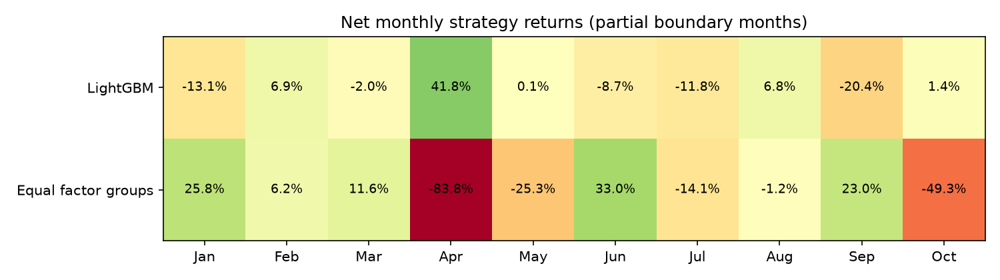

# Crypto Momentum & ML Factor Research

[](pyproject.toml)
[](src/crypto_factor_research/execution.py)
[](src/crypto_factor_research/first_window.py)
[](#results)

Crypto perpetual-futures long/short research combining momentum, funding, and
aggressive trade imbalance. The project compares LightGBM forecasts with simple
factor scores, momentum sorting, and random portfolios using NautilusTrader and
an independent accounting audit.

**Current release: dynamic-universe annual backtests for 2022–2026.** The project
covers data engineering, chronological model evaluation, TreeSHAP explanations,
execution simulation, and cost sensitivity. It is a research implementation;
paper and live trading are not implemented.

## Research question

Can a nonlinear combination of economically motivated signals improve portfolio
selection relative to transparent rules, after trading costs and funding?

| Signal group | Features | Interpretation |
| --- | --- | --- |
| Momentum | 20-, 60-, and 120-day returns | Trend persistence |
| Funding | Seven-day funding signal | Leverage demand and holding cost |
| Trade imbalance | Seven-day taker-quote imbalance | Aggressive buying versus selling |

Size and news signals are outside this version. The momentum horizons are model
inputs, not a staged-entry or market-timing overlay.

## Data and universe

- Binance USDⓈ-M trade bars, mark prices, and observed funding history, with
  dated contract identity, product-scope, and cessation evidence.
- The acquired catalog contains **924 identifiers**. Eligibility is evaluated
  at historical decision dates; catalog membership does not imply tradability.
- Annual preparation loaded 211 identifiers for 2023, 312 for 2024, 538 for 2025,
  and 663 for 2026, including training history. These counts are **not** the
  number eligible simultaneously or held by the strategy. Each portfolio holds
  at most five longs and five shorts.
- Public-source recovery preserves original observations and records source
  hashes. Future holding-data gaps are not used to filter earlier selections.

This replaces the earlier fixed 37-identifier prototype as the headline study.
Older continuous-account results remain historical documentation and should not
be mixed with the dynamic-universe results below.

## Method

1. Fit a LightGBM **regressor** on expanding historical training windows, starting
   in 2021. Predict seven-day price returns and rank assets within each date.
2. Admit training labels only after their holding period and availability buffer
   have matured before the annual cutoff. The model is held fixed during each
   evaluation year. TreeSHAP contributions are saved and checked for additivity.
3. Rebalance every two weeks. With at least 20 candidates, target five longs and
   five shorts at +10% / −10% NAV each: 100% gross, zero target net notional.
   Actual exposure drifts between decisions; zero net notional is not zero beta.
4. Compare against a 60-day momentum sort, an equal-weight combination of the
   three factor-group ranks, 20 seeded random sorts, and matched BTC/ETH spot
   holding benchmarks. Factor-score weights and portfolio weights are distinct.
5. Simulate fills and funding in NautilusTrader, then independently reconstruct
   positions, fees, funding, cash, and daily marked NAV from the ledgers.

Perpetual orders use a **5 bps taker fee without BNB discount**, plus adverse
slippage scenarios of **5 / 10 / 20 bps per execution**. This is a current-cost
assumption, not a reconstruction of every historical fee tier. Execution uses
VWAP/mark proxies and fractional research quantities; no order-book queue or
exchange liquidation engine is modeled.

## Results

Net returns at **5 bps slippage**, including fees and funding:

| Evaluation year | LightGBM | Equal factor scores | 60-day momentum | BTC spot | ETH spot |
| --- | ---: | ---: | ---: | ---: | ---: |
| 2022 | **+21.76%** | −18.56% | −45.74% | −64.63% | −67.97% |
| 2023 | +51.56% | +44.31% | +25.86% | **+154.51%** | +91.03% |
| 2024 | −7.19% | **+116.62%** | −27.50% | +116.47% | +44.98% |
| 2025 | +31.51% | **+63.93%** | −67.10% | −6.20% | −11.79% |
| 2026, through Oct 31 00:00 UTC | −10.33% | −87.33% | **+351.61%** | −12.79% | −25.15% |

2022–2023 are development windows, 2024 is validation, and 2025–2026 are the
originally designated OOS dates. Each annual simulation starts with USDT 100,000,
closes at its own boundary, and trains through the preceding year. These are
**separate annual accounts**, not an uninterrupted strategy or buy-and-hold path.
The final snapshot excludes trading later on October 31.

LightGBM risk metrics and cost sensitivity:

| Year | Sharpe, rf = 0 | Maximum drawdown | Return at 10 bps slippage | Return at 20 bps slippage |
| --- | ---: | ---: | ---: | ---: |
| 2022 | 0.79 | −18.48% | +19.28% | +14.46% |
| 2023 | 1.42 | −21.07% | +48.11% | +41.42% |
| 2024 | −0.01 | −37.75% | -9.40% | -13.66% |
| 2025 | 0.75 | −33.08% | +28.54% | +22.80% |
| 2026, partial | 0.09 | −45.03% | −11.99% | −15.21% |

LightGBM made money in three of five windows and avoided the extreme annual
swings of the simple controls. Its 2024 and 2026 losses, and 45% drawdown in 2026,
do **not** establish a stable trading edge or deployment readiness. Simple
controls also show why one strong year is insufficient evidence.



*2026 only; boundary months are partial. The funding assumption below applies.*

### Accounting evidence and limitations

- **2026 funding assumption:** missing internal June 24 funding slots use the
  mean of adjacent original rates, applied only to accounting after model fitting.
  The following anchor is future information at the missing event time. These are
  estimated costs, not proven settlements; they affect cash and later position
  sizes. The LightGBM 5 bps case used 12 estimated payments totaling −17.67 USDT.
- All 29 completed 2026 cases passed independent accounting checks, with a maximum
  NAV/cash difference below 0.000001 USDT and an identical primary replay.
  One of 20 random controls recorded nonpositive NAV and remains **failed**.
  The report explicitly has partial control coverage; the full suite did not pass.
  No full-period return or liquidation outcome is invented for that control.
- Funding assumptions, proxy execution, fractional lots, changing contract rules,
  and the absence of historical order books limit real-money interpretation.

[Published aggregate metrics and source-report hashes](docs/results/dynamic_annual_summary.json)
contain the five annual snapshots. Market observations, model binaries, detailed
ledgers, and generated working reports are excluded from Git.

## Repository layout

```text
src/crypto_factor_research/  # dynamic universe, annual models, execution and audits
src/momentum_data/          # shared components and preserved prototype engine
config/                    # explicit annual windows and scenario settings
scripts/                   # thin launchers and saved-result reporting
experiments/               # preregistrations and acceptance criteria
tests/                     # source, timing, portfolio and accounting checks
docs/                      # methodology, runbooks and aggregate results
research/legacy/           # earlier experiments and research history
```

## Installation and usage

Linux/WSL, Python 3.13:

```bash
python -m pip install -r requirements/research-runtime-py313.txt
python -m pip install -e ".[research,dev]"
python -m crypto_factor_research --help
python -m momentum_data smoke
python -m pytest tests -q
```

The synthetic smoke example needs no market data or API key. Historical research
requires the ignored local data lake and prepared source evidence; cloning the
repository alone does not reproduce historical results.

With those local inputs present, an individual annual run is explicit:

```bash
python -m crypto_factor_research window --config config/dynamic_2025.json --stage all
```

For the existing 2026 mean-funding run, audit and render saved results without
training or simulating again:

```bash
python scripts/report_saved_window.py \
  --config config/dynamic_2026_mean_funding.json \
  --run-dir data/processed/dynamic_2026_mean_funding/ff50164f4ed092093408 \
  --allow-failed-random-controls
```

See the [funding scenario runbook](docs/RUN_MEAN_FUNDING_OOS.md) for the assumption
and strict-default batch behavior, and [project status](docs/PROJECT_STATUS.md)
for the latest verified work. Default reporting continues to reject failed cases;
the explicit partial-report flag cannot bypass candidate or replay failures.

## Selected references

- Liu, Y., & Tsyvinski, A. (2021). [Risks and Returns of Cryptocurrency](https://doi.org/10.1093/rfs/hhaa113). *The Review of Financial Studies*.
- Liu, Y., Tsyvinski, A., & Wu, X. (2022). [Common Risk Factors in Cryptocurrency](https://doi.org/10.1111/jofi.13119). *The Journal of Finance*.

These papers motivate cryptocurrency return predictability and factor research;
the implementation here is an independent perpetual-futures experiment.
