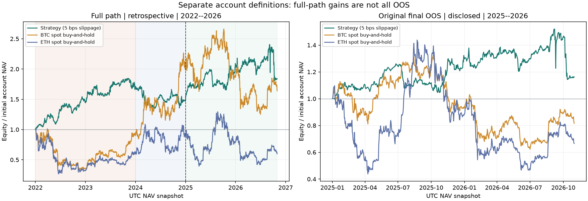
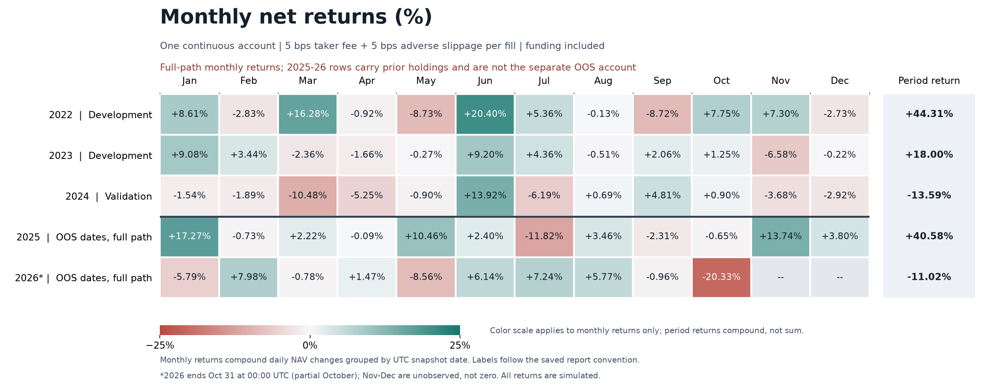

# Continuous reconstruction results: 2022--October 2026

This is an uninterrupted NautilusTrader simulation using frozen annual model caches,
not a product of independent annual NAV resets. All years were already inspected
when Experiment 016 was registered. The full path is retrospective, not fresh OOS.

## Full period versus original OOS

| Period | Role | Interpretation |
| --- | --- | --- |
| 2022--2023 | Development / selection | Used to inform strategy and execution choices |
| 2024 | Frozen validation | Revealed before the final holdout |
| 2025--October 2026 | Original final OOS; now disclosed | Protocol015 separate account; frozen annual expanding fits |
| 2022--October 2026 | Full retrospective reconstruction | Protocol016 registered after all annual results were observed |

| Account / period | Return | CAGR | Sharpe (rf=0) | MDD |
| --- | --- | --- | --- | --- |
| Full path (2022--2026) | +84.06% | +13.45% | 0.645 | -26.77% |
| Original OOS account (2025--2026) | +16.31% | +8.61% | 0.435 | -24.79% |
| OOS-date slice of full path; carry-in diagnostic | +24.08% | +12.51% | 0.557 | -24.79% |

All primary rows include 5 bps adverse slippage plus 5 bps perpetual taker fees and
Funding. The original OOS account starts with USDT 100,000 in cash on Jan 1, 2025;
it does not inherit 2024 positions. The full-path diagnostic carries positions/capital
from 2024 and is rebased at exactly the same Jan 1, 2025 NAV timestamp. It is **not**
a substitute OOS result. The +84.06% whole-period result is also **not all OOS**.
All comparisons end Oct 31, 2026 00:00 UTC; the last civil day is not included.
Development years may contain chronological forward forecasts but were used for
rule selection; that does not make them the clean final test.



### Original OOS benchmark comparison

| Original OOS series | Return | CAGR | Sharpe (rf=0) | MDD |
| --- | --- | --- | --- | --- |
| Strategy (5 bps slippage) | +16.31% | +8.61% | 0.435 | -24.79% |
| BTC spot buy-and-hold | -18.36% | -10.49% | -0.043 | -52.97% |
| ETH spot buy-and-hold | -33.42% | -19.93% | 0.016 | -67.55% |

Original OOS 10 bps strategy stress: return **+12.25%**,
Sharpe **0.367**, MDD **-24.95%**. Primary OOS:
**12/22 positive months**.
Models use frozen annual expanding windows: 2025 uses matured 2021--2024 labels;
2026 may use matured 2025 labels, as preregistered. This is walk-forward evaluation,
not a single model trained once and held unchanged throughout OOS.

The OOS was originally withheld and is now revealed. Reusing these dates for new
choices does not create a new independent OOS. The 37-identifier conditional-universe,
execution/funding proxy and incomplete matched momentum-control limitations still
apply. The ML OOS cases are verified; the broader protocol's blocked EOS control
cases are not converted into completed cases by this publication.

The heatmap below belongs to the **full retrospective account**, including its
2025--2026 carry-in holdings. It must not be read as the original OOS account's monthly
return table. The latter's exact monthly values are reported separately below.

### Original OOS monthly net returns

| Original OOS account | Jan | Feb | Mar | Apr | May | Jun | Jul | Aug | Sep | Oct | Nov | Dec |
| --- | --- | --- | --- | --- | --- | --- | --- | --- | --- | --- | --- | --- |
| 2025 | +9.04% | -0.73% | +2.22% | -0.09% | +10.46% | +2.40% | -11.82% | +3.46% | -2.31% | -0.65% | +13.74% | +3.80% |
| 2026 | -5.79% | +7.98% | -0.78% | +1.47% | -8.56% | +6.14% | +7.24% | +5.77% | -0.96% | -20.33% | N/A | N/A |

Monthly values use the same ending-UTC-NAV-date buckets as the existing reports.

Original OOS source: `data/interim/final_holdout/v20261122_003`; case 5 bps manifest SHA256: `3c00647be9541cc63ca8bf6fc5d2999b7ea4972032e2362f3e09a43884b33551`.


## Whole-path results

Start: 2022-01-01 00:00 UTC. Last NAV: 2026-10-31 00:00 UTC; final liquidation
2026-10-30 23:00 UTC. 1,765 NAV snapshots / 1,764 daily returns. Initial cash
USDT 100,000; primary ending NAV USDT 184,056.59.

| Series | Total return | CAGR | Sharpe (rf=0) | MDD | Annual vol. | Calmar |
| --- | --- | --- | --- | --- | --- | --- |
| Strategy (5 bps slippage) | +84.06% | +13.45% | 0.645 | -26.77% | +24.13% | 0.503 |
| Strategy (10 bps slippage) | +67.56% | +11.27% | 0.564 | -27.96% | +24.16% | 0.403 |
| BTC spot buy-and-hold | +64.02% | +10.78% | 0.455 | -66.93% | +50.34% | 0.161 |
| ETH spot buy-and-hold | -40.13% | -10.07% | 0.185 | -74.01% | +68.33% | -0.136 |

Perpetual fees are 5 bps taker per fill, no BNB discount, plus the indicated adverse
slippage. Funding is included using completed-hour mark proxies and pre-fill holdings.
Spot benchmarks hold fixed units from Jan 1 2022 02:00 UTC to the final sale, with
10 bps taker fee and 5 bps slippage each side. Different exposures prevent interpreting
this simple comparison as a market-beta-adjusted alpha estimate. Historical rates
are simulation assumptions; the project does not certify every historical fee tier.

## Monthly returns



| Year | Jan | Feb | Mar | Apr | May | Jun | Jul | Aug | Sep | Oct | Nov | Dec | Period |
| --- | --- | --- | --- | --- | --- | --- | --- | --- | --- | --- | --- | --- | --- |
| 2022 | +8.61% | -2.83% | +16.28% | -0.92% | -8.73% | +20.40% | +5.36% | -0.13% | -8.72% | +7.75% | +7.30% | -2.73% | +44.31% |
| 2023 | +9.08% | +3.44% | -2.36% | -1.66% | -0.27% | +9.20% | +4.36% | -0.51% | +2.06% | +1.25% | -6.58% | -0.22% | +18.00% |
| 2024 | -1.54% | -1.89% | -10.48% | -5.25% | -0.90% | +13.92% | -6.19% | +0.69% | +4.81% | +0.90% | -3.68% | -2.92% | -13.59% |
| 2025 | +17.27% | -0.73% | +2.22% | -0.09% | +10.46% | +2.40% | -11.82% | +3.46% | -2.31% | -0.65% | +13.74% | +3.80% | +40.58% |
| 2026 | -5.79% | +7.98% | -0.78% | +1.47% | -8.56% | +6.14% | +7.24% | +5.77% | -0.96% | -20.33% | N/A | N/A | -11.02% |

Cells compound daily marked-equity returns, net of fees/funding/slippage, grouped
by the ending UTC NAV snapshot date. These are the existing report's month buckets,
not a newly reconstructed exchange-calendar month-end series. For example, a
return ending Feb 1 00:00 UTC belongs to February, although its interval starts Jan 31.
January 2022 starts with initial NAV; October 2026 ends at Oct 31 00:00 UTC and omits
that civil day's trading. Missing November/December cells are N/A, never zero.
Period totals compound the monthly cells; they are not sums or annualized partial years.

| Year | Positive months | Median month | Best month | Worst month |
| --- | --- | --- | --- | --- |
| 2022 | 6/12 | +2.61% | +20.40% | -8.73% |
| 2023 | 6/12 | +0.51% | +9.20% | -6.58% |
| 2024 | 4/12 | -1.71% | +13.92% | -10.48% |
| 2025 | 7/12 | +2.31% | +17.27% | -11.82% |
| 2026 | 5/10 | +0.35% | +7.98% | -20.33% |

There are **28/58 positive months (48.28%)**; the
monthly median is **-0.11%**. Best: **2022-06,
+20.40%**. Worst: **2026-10, -20.33%**.
The best month accounts for 26.94% of additive
net cash profit along this path. Compounding the other months gives
+52.87%; this is a descriptive concentration
check, not an executable counterfactual strategy or proof of stable performance.

## Continuous annual slices

| Year | Strategy | BTC spot | ETH spot |
| --- | --- | --- | --- |
| 2022 | +44.31% | -64.53% | -67.89% |
| 2023 | +18.00% | +153.74% | +90.97% |
| 2024 | -13.59% | +120.20% | +46.70% |
| 2025 | +40.58% | -4.64% | -11.55% |
| 2026 (partial) | -11.02% | -13.20% | -24.77% |

These slices include the return ending Jan 1 in its new year, using the preceding
Dec 31 NAV as the base. 2022 starts at the initial NAV. Their products reconcile
to the whole-period return; there are no synthetic flat bridges or annual liquidations.
The two-week phase still restarts at the first Monday of each year as originally
specified, which can create 7/21-day year-crossing intervals. New annual scores
apply at the next scheduled rebalance; the account keeps existing quantities until then.

The return ending Jan 1 alone is:

| Year | Cross-year daily strategy return |
| --- | --- |
| 2023 | +0.24% |
| 2024 | -0.35% |
| 2025 | +0.81% |
| 2026 | -0.83% |

Standalone annual backtests start from fresh cash and close at their own endpoint;
carry-over holdings, accumulated capital and omitted bridge days explain why those
results need not match these slices. The 2025 continuous slice is +40.58%, not the
previous +30.61% standalone run; do not mix the two definitions.

## How much comes after development?

2022--2023 informed strategy/execution selection. 2024 was a frozen validation;
2025--2026 were originally held out and are now disclosed. The uninterrupted
reconstruction was authorized after all of those results were observed. Existing
separate holdout reports retain their own protocol and account boundaries.

The following diagnostic starts at Dec 31 2023 NAV and includes all returns ending
in 2024 onward. It was calculated for reporting, not registered as a new independent test:

| Series | 2024 onward return | Sharpe (rf=0) | MDD |
| --- | --- | --- | --- |
| Strategy (5 bps slippage) | +8.09% | 0.238 | -24.79% |
| BTC spot buy-and-hold | +82.25% | 0.685 | -52.97% |
| ETH spot buy-and-hold | -2.38% | 0.320 | -67.55% |

The full-period +84.06% therefore should not be presented as evidence that returns
were uniformly strong. 2024 and partial 2026 lose money, and October 2026 alone
loses 20.33%. 2025 contributes strongly. The post-development aggregate is only
+8.09%; most of the full-period compounding advantage comes from development years.
A positive-month hit rate below 50% alone does not invalidate a strategy: payoff
sizes matter. The weak post-development risk-adjusted result and large loss month
are more consequential than the hit rate alone. A month-by-month heatmap reveals
this unevenness but cannot establish significance or deployment readiness on its own.

## Registered gates and accounting verification

| Registered descriptive gate | Result |
| --- | --- |
| positive_10bps_stress_return | Pass |
| positive_net_return_and_sharpe | Pass |
| positive_return_excluding_best_month | Pass |
| sharpe_above_both_spot_benchmarks | Pass |
| smaller_MDD_than_both_spot_benchmarks | Pass |

These are descriptive screening thresholds from Experiment 016, not significance
tests. Two financial cases and one exact primary replay completed; all required
source proxies passed preflight, annual cash resets=0, new model fits=0. The report
requires independent source-VWAP/slippage/fee and pre-fill funding reconstruction,
daily-ledger reconciliation and ending-ledger error <= USDT 0.01. Contracts and
saved case/report hashes were reverified before generating these documents.

Primary cumulative taker fees: USDT 15,609.10; signed funding
cashflow: USDT 7,986.78; gross traded notional (both sides):
USDT 31,218,209.02. Cumulative fees are cash amounts
along a changing-capital path, not a simple percentage drag on starting capital.
SHAP remains annual prediction attribution, not causal attribution of trading profit.

## Supported conclusion and unresolved limits

The retrospective path shows lower realized volatility/drawdown than unscaled
BTC/ETH holding and positive returns under the registered 10 bps slippage stress.
Monthly consistency is weak: fewer than half the months are profitable, the median
month is negative, and the recent period includes a large monthly loss. This supports
retaining the project as a reproducible research result and considering a separately
specified forward paper evaluation, not calling it a proven profitable live strategy.

The 37-identifier cohort is conditional and retrospectively reviewed; its historical
publication vintage is not proven. Hourly VWAP/slippage and completed-hour funding
marks approximate execution; historical lots, margin, liquidation, order-book impact
and live operational performance are not certified. No portfolio risk guarantee
follows from the lower historical MDD. The momentum-only control remains blocked
by missing verified EOS terminal settlement evidence and is not replaced or silently
excluded to claim alpha. No fresh OOS remains in these inspected dates.

## Reproduce and audit

From the WSL funding-strategy environment, run the existing simulator first if
results are absent; then publish the verified saved outputs:

```bash
python scripts/run_continuous_reconstruction.py --stage all
python scripts/run_continuous_reconstruction.py --stage summary
python scripts/publish_continuous_results.py
```

Publishing performs no fitting, downloading or historical simulation. It reproduces
monthly/annual summaries from saved daily NAV and checks the report hashes first.
See [runbook](CONTINUOUS_RECONSTRUCTION_RUNBOOK.md),
[registration](../experiments/016_continuous_2022_2026.md) and
[English notebook](../notebooks/continuous_reconstruction_results.ipynb).
Only summarized results and the figure are published in Git; source data stay ignored.

Historical contracts retain their original logical source names. Original script
bytes now live under `research/legacy/scripts/`, and original analysis source under
`research/legacy/src/`; the active verifier resolves these preserved files rather
than deleting or revising the old contracts. Refactored replays have a separate
package contract and must produce identical financial hashes.

Verified source hashes for this publication:

- `data/interim/continuous_reconstruction/v20261122_001/contract.json`: `656e168a23137280dc7d64d0e945b24947dfb3ee126f438ac0b5ec82b5e2193a`
- `data/interim/continuous_reconstruction/v20261122_001/summary.json`: `0f29514d3892be1758aa4069fc3bfd48b1aeeb0198da76d1f7cc85ae1cd0139e`
- `data/interim/continuous_reconstruction/v20261122_001/report_complete.json`: `314915093fe3263bf27dcf3d01fb617a4351abcb0117e1c2b17b6e47d07accc2`
- `reports/tables/continuous_reconstruction/daily_5bps.csv`: `bd3a05f0d335edadd2e050e0db9055a528094a39b3f520e610a8724fdb870a3a`
- `reports/tables/continuous_reconstruction/monthly_returns_5bps.csv`: `c38c4689c7325921f4c0a1e424c95a4dd222900ede9fb0a3ebc967ca4c9dbb1b`
- `reports/tables/continuous_reconstruction/year_slices_5bps.csv`: `3e4e1ea42ada89b562be87c3b650b141460496965b05e387137dedb9ca43d595`

Publisher SHA256: `f309162c2bff95bb4b8dec16b286b4199f996553ec2efb8037b019b90519c67f`.
